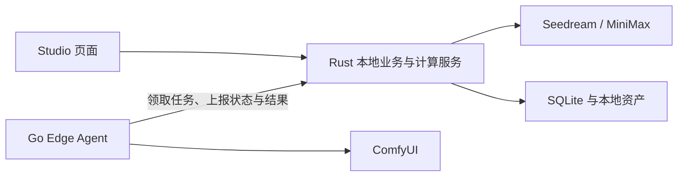

# Pixoma Studio 独立运行设计

日期：2026-10-29

状态：功能布局已确认；本文定义技术实施范围。实现与真实服务验证按 `docs/implementation-plan.md` 执行。

## 1. 产品与工程范围

Pixoma Studio 使用现有 Tauri、Rust 和 React 工程，独立维护项目、会话、资产、技能、专家、MCP、工作流及计算节点。应用直接进入创作页面，全部业务使用单一本地数据空间。

所有业务表、Rust 方法、前端类型和查询参数均移除 `account_id`、平台身份与账号范围。登录、注册、个人资料、密码、平台目录、发布与平台地址配置从产品和运行代码中移除。应用启动、构建、安装和运行均不依赖 Pixoma 服务。

本次迁移功能与代码。数据库按本设计建立新结构，实施验证使用明确指定的全新应用目录；不读取或转换既有业务数据库，不清理用户当前目录。用户主动导入的工作流、技能包和媒体文件属于正常产品操作。

工程根目录为 `/Users/mr9esx/Documents/PixomaStudio`。前端组件和 Go 执行代码从 Pixoma 复制后独立维护；工程中不使用指向 Pixoma 的源码导入、Go replace、workspace、符号链接或共享数据库。

默认业务根目录使用 Tauri 本地应用目录下的 `standalone/`，数据库名称为 `studio-standalone.sqlite`。测试通过 `PIXOMA_STUDIO_DATA_DIR` 指定独立目录。启动清理只检查当前业务根目录内的临时文件。

## 2. 菜单与页面

布局依据为 `docs/demos/standalone-studio.html`。正式页面继续使用原 Studio 的组件、样式、品牌资源和 Pixoma 设计令牌。

| 入口 | 页面内容 |
| --- | --- |
| 对话 | 创作需求、模型、技能、专家、工作流与资产引用、审批、结果 |
| 资产库 | 项目资产、分类、筛选、版本、预览、使用记录和导出 |
| 工作流 | 全部、自建 ComfyUI、在线模型；图片、视频等输出分类独立筛选 |
| 技能 | 创建、编辑、导入、文件管理、版本、启停 |
| 专家 | 提示词、技能与工作流引用、模型、SOP、版本、启停 |
| 设置 → 对话模型 | 现有三种模型协议及连接配置 |
| 设置 → 生成服务 | 在线生成服务连接、凭据、模型能力检查 |
| 设置 → 计算节点 | 节点列表、详情、接入、Edge Agent 部署、状态与指标 |
| 设置 → MCP | 服务连接、工具发现、调用策略、凭据、启停 |
| 设置 → 会话 / 应用 | 会话管理、外观、语言、本地文件位置 |

工作流详情共用介绍、配置、版本、运行记录。ComfyUI 配置展示 JSON、输入输出绑定与单个节点选择；在线模型配置展示服务连接、模型、输入输出与默认参数。新建入口先选择工作流类型。

节点选择旁提供管理与新建入口。进入设置前保留编辑草稿，返回后继续编辑原工作流。计算节点由多个工作流共用，节点详情反向列出引用它的工作流。

产品中移除任务队列设置、Topic、订阅与路由规则。等待、运行和结果直接展示在工作流运行记录与会话中。

## 3. 运行组成

| 组成 | 职责 | 使用方式 |
| --- | --- | --- |
| React | 页面与交互 | 沿用 Tauri Commands、Channel 和已有 AG-UI 适配 |
| Rust 业务 | 本地业务、Agent、技能、专家、MCP、资产 | 在现有 Tauri 进程中运行 |
| Rust 计算服务 | 工作流校验、版本、执行记录、指定节点任务、在线模型、结果导入 | 共用现有 Store、Tokio 与取消机制 |
| Rust 节点接口 | Agent 心跳、领取任务、读取输入、状态上报、上传结果 | 使用 Axum 提供独立的 `/agent/v1` HTTP 接口 |
| Go Edge Agent | ComfyUI 调用、进度、指标、本地执行日志、结果传输 | 独立 Go module 与二进制；本机和远程采用相同协议 |
| SQLite 与文件 | 业务记录、执行恢复与实际媒体 | 使用应用目录；Agent 使用自己的数据目录 |

Rust 使用现有 SQLx、serde、reqwest、Tokio、Rig、rmcp，节点 HTTP 服务增加 Axum。JSON、YAML、ZIP、HTTP、WebSocket 与 SQLite 使用成熟依赖，具体发布版本由对应任务的编译和真实服务验证确定并保存到锁文件。

Go 迁移现有 ComfyUI Client、硬件与指标采集；使用 `net/http`、现有 WebSocket 依赖，以及 `database/sql` 与 `modernc.org/sqlite` 保存执行日志。移除 Go 对 Pixoma 内部包、平台 Blob 和 Topic Publisher 的运行依赖。

## 4. 工作流与本地数据

标识使用 UUID 字符串。所有持久字段和方法直接使用业务 ID；不保留账号占位值。

| 对象 | 主要内容 |
| --- | --- |
| `workflows` | `id`、名称、类型、分类、启停、`draft`、`default_version_id`、修订号 |
| `workflow_versions` | `id`、`workflow_id`、版本号、完整定义、内容摘要、创建时间 |
| `generation_connections` | `id`、名称、`provider`、地址、启停、配置修订号 |
| `generation_connection_versions` | 供未结束执行使用的连接配置与凭据；对外返回凭据是否存在 |
| `compute_nodes` | `id`、名称、位置、启停、凭据摘要、心跳、ComfyUI 能力、硬件与指标 |
| `workflow_executions` | 请求编号、工作流版本快照、执行状态、目标、远程任务编号、错误与时间 |
| `workflow_execution_events` | `execution_id`、递增序号、事件类型与内容 |
| `workflow_execution_outputs` | 输出字段、序号、内容摘要、本地资产版本、导入状态 |
| 现有业务表 | 保留项目、会话、消息、资产、模型、技能、专家、MCP、上下文和审批功能 |

### 工作流定义

共同字段为 `type`、`inputs`、`input_schema`、`outputs`、说明和示例。

`type=comfyui` 的 `execution` 保存 `node_id`、`workflow`、`input_bindings`、`output_bindings` 与导入文件名称。`node_id` 表示一个选定节点。保留后台已有的输入类型、JSON Schema 校验、参数位置、输出位置、图预览和字段生成能力。

`type=online` 的 `execution` 保存 `connection_id`、`provider`、`operation`、`model`、模型能力标识、`defaults` 与输入输出映射。模型能力由内置服务适配代码明确提供；未知模型能力需要用户选择受支持的模型系列，不能根据显示名称推断。

在线生成服务采用有类型的 Rust 模块处理请求与响应。工作流参数只引用已支持的字段，不允许通过任意 URL、请求模板或脚本创建新的网络执行器。

### 草稿、版本与引用

保存编辑内容更新草稿；创建版本保存完整不可变定义。运行与专家引用绑定具体版本。直接使用草稿进行测试时，先保存内容摘要与完整快照，运行记录标注草稿测试。

一次执行固定输入资产版本、目标节点或连接、实际模型、请求参数和输出绑定。后续编辑工作流、修改默认节点或更换默认模型均不改变已有执行。服务连接的原修订保留到相关执行结束；停用立即阻止新的提交，查询原任务仍使用已绑定修订。

删除当前工作流版本或未结束执行使用的节点、服务连接时，返回具体引用；可以停用。运行历史保留完整快照与实际输出。技能与专家继续保留版本、启停、文件和 SOP；会话使用已保存版本。

## 5. 自建 ComfyUI 执行

1. 从 Pixoma 复制工作流导入、图解析、字段绑定、输出绑定、基础信息与版本页面。
2. 选择节点后通过 Agent 获取实际 `/object_info` 与系统信息，核对节点类型、输入字段及输出位置。离线时可以保存草稿，提交执行需要节点就绪。
3. 使用工作流版本与实际输入创建执行记录，生成已绑定输入的任务包；素材引用保存为本地资产版本。
4. 指定 Agent 领取任务，保存执行日志，下载输入，再上传到 ComfyUI 并提交。
5. Agent 保存 `prompt_id`，订阅进度并读取原任务历史；输出按绑定字段取得实际字节。
6. Agent 上传结果并上报最终状态；Rust 导入本地资产、更新会话，再通知 Agent 结果已确认。

同一 Agent 同时处理一个 ComfyUI 执行。后续执行按创建顺序等待，运行记录显示等待节点。不同节点与在线服务可以并行。ComfyUI 外部客户端已有工作时，Agent 等待可用时机，并显示服务实际状态。

任务固定给所选节点，节点离线或执行中断后保持原目标。节点更换需要用户新建执行，历史记录保存原目标与原输入。

## 6. Edge Agent 接入与文件传输

### 网络与启动

节点服务默认监听 `127.0.0.1:18083`。远程接入由设置明确启用监听地址与 Agent 可访问地址；跨公网使用 HTTPS，局域网或 VPN 使用相应可达地址。本设计采用直接连接，远程接入的验收包含实际路由与防火墙检查。

Agent 主动连接 Studio，Studio 无需访问 Agent 的 HTTP 端口。远程机器上的 ComfyUI 通过该机器的 Agent 访问。服务监听失败显示具体错误，已配置节点无法使用，其他本地功能仍可读取。

创建节点生成随机凭据。Rust 保存凭据摘要，Agent 使用 Bearer 请求；权限限定为当前节点领取的执行及相关文件。每次请求核对节点启停、凭据和执行归属。凭据重置后旧凭据立即失效。

停用节点停止新的领取，原执行仍可上报心跳与结果。节点凭据失效后返回明确错误，Agent 保留执行日志与结果文件，等待更新凭据。

本机节点使用随安装包提供的同版本 Go Agent，在配置完成后由 App 启动，配置与执行日志写入本机节点目录。远程 Agent 独立安装运行。重复启动使用 Agent 数据目录锁拒绝第二个进程。

### HTTP 接口

| 方法与路径 | 输入与结果 |
| --- | --- |
| `GET /agent/v1/jobs/claim?wait=25s` | 凭据确定节点；返回指定节点的一个任务或 HTTP 204 |
| `POST /agent/v1/presence` | 版本、启动编号、ComfyUI 状态、硬件、指标；返回启停及配置修订 |
| `GET /agent/v1/executions/{id}/package` | 领取后的任务包、输入文件 ID、预期大小与 SHA-256 |
| `GET /agent/v1/executions/{id}/inputs/{file_id}` | 实际文件流；支持 Range 与内容摘要 |
| `POST /agent/v1/executions/{id}/heartbeat` | `attempt_id`；返回是否请求取消 |
| `POST /agent/v1/executions/{id}/events` | `attempt_id`、单调递增 `sequence`、`kind`、`payload` |
| `PUT /agent/v1/executions/{id}/outputs/{output_id}` | 文件流、预期长度、SHA-256、MIME；重复请求返回同一结果 |
| `POST /agent/v1/executions/{id}/complete` | 输出清单或实际错误；确认 Rust 已保存结束状态 |

任务包字段为 `protocol_version`、`execution_id`、`attempt_id`、`workflow_version_id`、`workflow`、`inputs`、`outputs`、`input_files`、`content_digest`。文件地址使用当前服务的相对路径。未知协议版本直接拒绝领取。

领取成功返回 `execution_id`、`attempt_id`、`package_url` 与 `protocol_version=1`。文件清单包含 `file_id`、`size_bytes`、`sha256`、`media_type`；输出清单另含 `field_key` 与 `index`。摘要使用 SHA-256 小写十六进制字符串。

| 事件 `kind` | 必要内容 | 处理规则 |
| --- | --- | --- |
| `accepted` | 任务包摘要 | 确认 Agent 已保存任务，随后允许执行 |
| `submission_started` | 提交内容摘要 | 保存即将向 ComfyUI 发出请求的阶段 |
| `submitted` | `prompt_id` | 保存实际编号，后续只查询原任务 |
| `progress` | 实际节点、当前步数与总步数，或实际节点状态 | 服务没有提供步数时只展示阶段 |
| `submission_unknown` | 失败阶段与错误信息 | 暂停新的提交，保留原尝试 |
| `failed` / `cancelled` | 错误信息或服务取消确认 | 校验当前阶段后保存真实结束状态 |

成功通过 `complete` 请求确认，提交 `status` 与全部输出清单。协议拒绝越序结束、未确认输出和摘要不一致；HTTP 400 表示参数错误，401 表示凭据失效，403 表示执行归属错误，409 表示状态或内容冲突。重复相同请求返回原确认内容。

领取在 SQLite 事务中完成。任务已有未结束 `attempt_id` 时不重新分配；Agent 重连先恢复本地日志中的原执行。事件按执行、尝试和序号去重，相同序号不同内容返回冲突。完成请求先检查全部输出已确认。

领取响应丢失时，同一节点再次领取返回同一未确认尝试。Agent 保存日志并上报 `accepted` 事件后才能提交 ComfyUI；恢复到已接受但提交阶段无法确认的尝试时，先查询原任务，无法确认则保留未知状态。

Agent 每 10 秒上报在线状态与当前执行心跳，每 30 秒附带指标；35 秒没有在线状态即显示连接异常。连接超时不会产生新的执行尝试。Go 日志数据库名称为 `agent.sqlite`。

输入下载和结果上传经过长度、摘要、授权和路径检查。上传采用流式写入应用目录的临时文件，验证完成后原子替换；中断文件不会形成资产引用。重试只传输原文件，不能触发再次计算。Agent 与 Studio 不要求共享文件系统。

### Agent 本地执行日志

Agent 在 SQLite 中保存任务包摘要、提交阶段、`prompt_id`、进度事件序号、输出文件与最终上报确认。下载文件与输出文件使用执行 ID 下的独立目录。

发送 ComfyUI 请求之前先保存提交意图；收到编号后立即保存编号。请求中断时，按提交附带的执行标识核对 ComfyUI 的队列与历史；不能唯一确认时上报 `submission_unknown`，不再次提交。收到 Rust 的结束确认后，清理该执行的临时输入、输出与日志。

## 7. 执行状态、取消与恢复

计算状态与会话等待状态分别保存。会话停止等待后，已经接受的外部计算仍按真实状态记录结果。

| 状态 | 含义 | 恢复动作 |
| --- | --- | --- |
| `pending` | 已保存，尚未发出执行请求 | 校验目标后继续处理 |
| `dispatching` | 已领取或正在向在线服务提交 | 恢复原尝试；核对提交结果 |
| `running` | 已保存外部编号，或同步生成请求正在进行 | 查询原任务；同步请求中断时核对已保存输出 |
| `collecting` | 外部计算已完成，正在保存输出 | 继续下载或上传已有输出 |
| `succeeded` | 声明的输出全部形成可读资产 | 展示原结果 |
| `partially_succeeded` | 已取得部分输出并保存逐项错误 | 展示成功项与错误项 |
| `failed` | 有明确的输入、服务或执行错误 | 展示具体原因；手动重试创建新执行 |
| `cancelled` | 未提交时取消，或服务已确认取消 | 展示取消结果 |
| `submission_unknown` | 请求可能已接受但编号未确认 | 核对原尝试，禁止自动再次提交 |

节点断线是连接状态，不能据此把外部计算标记失败。心跳过期后显示黄色与最后联系时间；恢复连接后继续查询原执行。查询、下载、状态上报允许按原编号重试；生成请求不自动重试。

未领取执行在本地直接取消。ComfyUI 已接受的待执行任务按 `prompt_id` 删除；运行中仅使用经真实版本验证的定向取消。服务不支持定向取消时返回能力限制。取消与领取共用事务检查，Agent 在提交前再次检查取消标记。

在线服务的取消能力见调研文档。停止等待只解除当前 Agent 会话的等待，结果查询与导入继续保存。再次生成使用新的 `request_id`，并在界面显示新的执行记录。

关闭窗口沿用 Tauri 生命周期；退出 App 时停止领取新执行，保存状态并在有限时间内结束网络请求。本机 Agent 随 App 退出，已经被 ComfyUI 接受的任务可由 ComfyUI 继续处理；远程 Agent 继续当前执行并保存结果。App 重新打开后恢复原编号。电脑休眠期间暂停本地请求，唤醒后按相同规则恢复。

## 8. 在线生成服务

生成服务连接由设置统一维护。工作流选择连接、模型、操作类型与默认参数，运行中提交给服务端；前端不取得凭据。

本次接入火山方舟 Seedream 图片生成与 MiniMax H3 视频生成。服务差异集中在 `src-tauri/src/generation/seedream.rs` 与 `minimax.rs`，由 `provider` 和 `operation` 枚举分派，不建立任意执行插件系统。

Seedream 使用图片生成接口。Rust 校验模型系列、提示词、参考图片、尺寸与输出能力，消费服务支持的完整响应或流式事件，立即保存得到的媒体与逐项错误。响应中断且没有可查询任务编号时记录 `submission_unknown`。

MiniMax 使用 V2 视频任务接口。Rust 保存 `task_id` 后按原编号查询，下载实际视频并交由现有媒体处理生成封面与索引。参数根据所选模型与操作检查，返回结果保存实际模型、用量和服务请求编号。

本地素材由 Rust 读取授权的资产版本并按服务支持的 Base64 或上传文件方式提交。桌面文件路径和 `pixoma-media` 地址不作为在线服务的素材 URL。任何素材上传只包含本次执行所需文件。

连接测试只验证鉴权、模型与接口访问能力；会产生生成请求的检查明确使用工作流测试操作。接口能力、查询时效与取消限制的来源和验证条件见 `docs/standalone-research.md`。

服务没有独立的无生成请求检查方式时，连接表单只完成本地配置检查并显示尚未验证；真实生成通过后才记录已经验证的能力。

## 9. 技能、专家、MCP 与 Agent

技能列表直接读取本地技能；创建、编辑、Markdown 与 ZIP 导入、附带文件、版本、启停保留现有能力。运行固定技能版本和内容摘要。专家引用本地技能与工作流版本，头像保存为本地资产，SOP 和结果确认继续使用已有组件。

MCP 由本地设置维护连接、凭据、发现结果与调用策略。保留现有 rmcp 工具发现、审批、真实图片内容、异步任务、实时补充输入与 MRTR 继续状态。服务中断后的结果未知状态保留，可能已执行的工具不能自动重复调用。

本地工作流通过专用工具 `list_workflows`、`get_workflow`、`run_workflow`、`get_workflow_execution` 接入现有 Agent。工具注册使用独立内部名称，界面展示工作流名称；不会覆盖外部 MCP 服务中同名工具。审批和补充输入直接消费工作流版本中的 JSON Schema，提交后保存执行 ID 与工具调用关系。

保留三种模型协议和三种权限模式，保留上下文压缩、资产版本引用、事件续接、工具结果、专家步骤与运行轨迹。会话内按顺序执行，不同会话允许并行。重新启动时直接恢复本地运行，不执行身份读取。

## 10. 本地业务与页面状态

保留项目与会话、文档历史、分类、标签、评分、归档、批量操作、重复内容、使用记录、图片与视频预览、Range 和导出。

应用目录锁、媒体文件检查、事务与启动临时文件清理继续使用现有实现。视频处理继续使用随包 FFmpeg；图片分析保留实际尺寸与调色盘。凭据在 Rust 中读取，日志、事件、普通配置 DTO 和运行轨迹清除凭据。

页面主体使用 `--card`，内部说明与侧栏使用语义次级表面，输入使用 `--background`，浮层使用 `--popover`。组件优先复用已有 shadcn/ui。导航、空状态和对象引用使用现有图标清单。

健康显示统一使用 `StatusDot`。启停、服务配置、节点连接、模型能力共同决定可用状态；信息未就绪显示黄色，全部检查通过才显示绿色。列表、详情、编辑器和运行前检查使用同一结果。错误显示具体原因，不替换目标节点、模型或协议。

## 11. 前端复制与调整清单

下表源路径相对于 `/Users/mr9esx/Documents/Pixoma`，目标路径相对于 Studio 根目录。已有目标组件按当前内容调整。

来源列中以 `features/` 开头的路径相对于 Pixoma 的 `web/admin/src/`。

| 功能 | 来源 | 目标与调整 |
| --- | --- | --- |
| 工作流编辑 | `web/admin/src/features/cases/workflow-editor.tsx`、`sections/` | `src/features/cases/`；保留导入与字段组件，替换执行配置区域 |
| 图解析与校验 | `features/cases/lib/workflow-parse.ts`、`derive.ts`、`node-catalog.ts` | 同功能目录；前端检查与 Rust 提交检查共用相同字段含义 |
| 详情与版本 | `features/cases/detail-panel.tsx`、`workflow-versions.tsx`、`workflow-version-list.tsx` | 同功能目录；沿用详情结构，连接本地版本与运行记录 |
| 节点列表与详情 | `features/edges/list-panel.tsx`、`detail-panel.tsx`、`edge-form.tsx` | `src/features/edges/`；嵌入 Studio 设置 |
| 指标与部署 | `features/edges/observation.ts`、`observation-panel.tsx`、`presence-tags.tsx`、凭据及部署组件 | `src/features/edges/`；显示 Studio 接入地址与 Go Agent 命令 |
| API 类型 | `web/admin/src/lib/api/cases.ts`、`edges.ts`、必要 DTO | `src/lib/api/workflows.ts`、`compute-nodes.ts`；改为本地请求 |
| 主导航与设置 | Studio 已有 `studio-sidebar.tsx`、`studio-workspace.tsx`、`studio-settings-layout.tsx` | 保留页面外壳，承接第二节菜单与两类工作流 |
| 在线生成配置 | 已有模型表单、Field、Select、Tabs、错误组件 | 在工作流原页面中组合生成服务字段 |
| 运行与会话 | Studio 已有工作流输入、轨迹和资产组件 | 连接本地执行记录，保留原输入与结果交互 |

实际复制必须包含 import 依赖、i18n 文案、样式与图标，并逐项检查。`TaskFlowTable`、`node-topic-picker.tsx` 与 Topic 校验不进入 Studio 产品功能。

## 12. 验收与执行证据

| 范围 | 通过条件 |
| --- | --- |
| 独立启动 | 全新应用目录直接进入 Studio；无平台地址、账号与身份请求 |
| 数据结构 | 业务表、方法、DTO 与查询不包含账号字段或占位账号 |
| 本地管理 | 技能、专家、模型、MCP 和资产全部通过真实本地数据完成操作 |
| 前端复用 | 原组件、类名、令牌与主要操作保留，菜单符合第二节 |
| 本机执行 | 随包 Go Agent 调用实际 ComfyUI，输入与结果字节可核对 |
| 远程执行 | 独立机器 Agent 通过真实网络收取素材并上传结果，无共享目录要求 |
| 在线生成 | 两个服务分别完成真实生成，结果形成可预览的本地资产 |
| 恢复 | 提交、编号保存、文件传输与最终确认各阶段中断后恢复原执行 |
| 重复操作 | 相同请求返回同一执行；事件与结果不产生重复资产 |
| 取消 | 未提交取消、服务确认取消、停止等待分别反映真实状态 |
| 安装包 | 构建与启动不读取 Pixoma 目录，包含 FFmpeg 与本机 Go Agent |

检查使用实际 SQLite、文件、ComfyUI、Edge Agent、模型与 MCP 服务。服务未具备验证条件时保留未验证状态，不以 mock、固定成功响应或测试替身补充证据。UI 使用源码、DOM、可访问性树和交互结果核验。

Rust、Go 与前端分别执行适用的格式、静态检查、测试和构建；安装包在实际目标系统验证。结果写入 `docs/standalone-verification.md`，记录版本、命令、输入摘要、真实任务编号、输出摘要与通过范围，清除凭据。

## 13. 调研与实施文件

- `docs/standalone-research.md`：源码依据、官方接口核查、能力限制与真实验证条件。
- `docs/implementation-plan.md`：按依赖顺序执行的任务、文件、接口、检查和验收。
- `docs/demos/standalone-studio.html`：菜单与功能布局参考。
